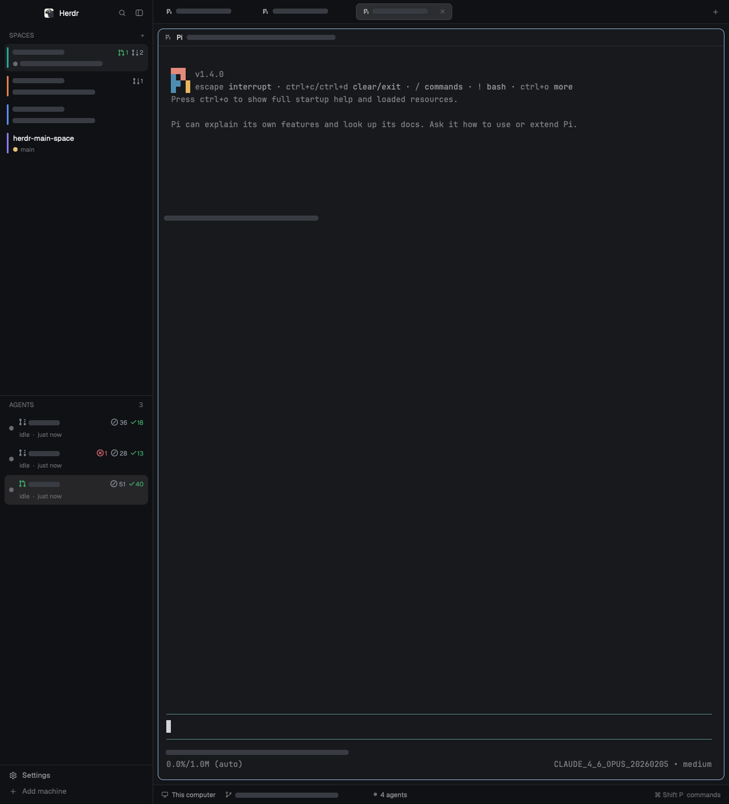

# Github Spaces for Herdr

Letter badges for spaces with agent-attention counts and pull-request totals by state, agents scoped to the selected space, and optional pull-request/CI badges alongside a terminal workspace.



Read [RECIPE.md](RECIPE.md) for the complete rebuild brief, behaviors, dependencies, and known limits. The preview is a real Herdr capture with private text covered for publication.

## Install

Requires Herdr; validated with 0.1.9. Read your `~/.config/herdr-app/AGENTS.md` and the recipe first. Both lists read an optional local PR status file; agent-attention counts use Herdr's live data. The optional Python helper runs Git and authenticated GitHub CLI queries. Herdr's Files/Changes panels read working folders, and Changes can stage and commit changes when requested.

Copy `layouts/github-spaces.json` into your Herdr `layouts/` directory and the three directories under `mods/` into its `mods/` directory. Keep the `space-status` directory even if the helper is unused. The built-in chrome, tabs, pane header, panels, menus, and icons come from your installed Herdr.

**Do not overwrite an existing layout or mod.** If a name is taken, rename the new copy and update its layout references and any self-references/asset paths. If `space-status` is renamed, update both list mods' status paths too. Leave this README, the recipe, and the public preview outside the app's config folder. No key bindings or personal settings need copying.

After copying under the original names:

```sh
herdr-app check ~/.config/herdr-app/mods/spaces-letter
herdr-app check ~/.config/herdr-app/mods/agents-space
herdr-app do layout.switch '{"name":"github-spaces"}'
```

For live PR/CI badges, authenticate `gh` and explicitly run:

```sh
python3 ~/.config/herdr-app/mods/space-status/refresh.py --repo /path/to/your/repository
```

This stays in the foreground. Stop it with Ctrl-C. It monitors one repository and its local worktrees; no background service is installed. Without it, the layout still shows normal agent titles and activity. The recipe documents the PR/query limits and the collapsed-sidebar limitation.

The layout uses Herdr's shipped chrome and panels. The custom mods contain only the space/agent list behavior described in the recipe. The agent mod bundles its glyph font and license.
