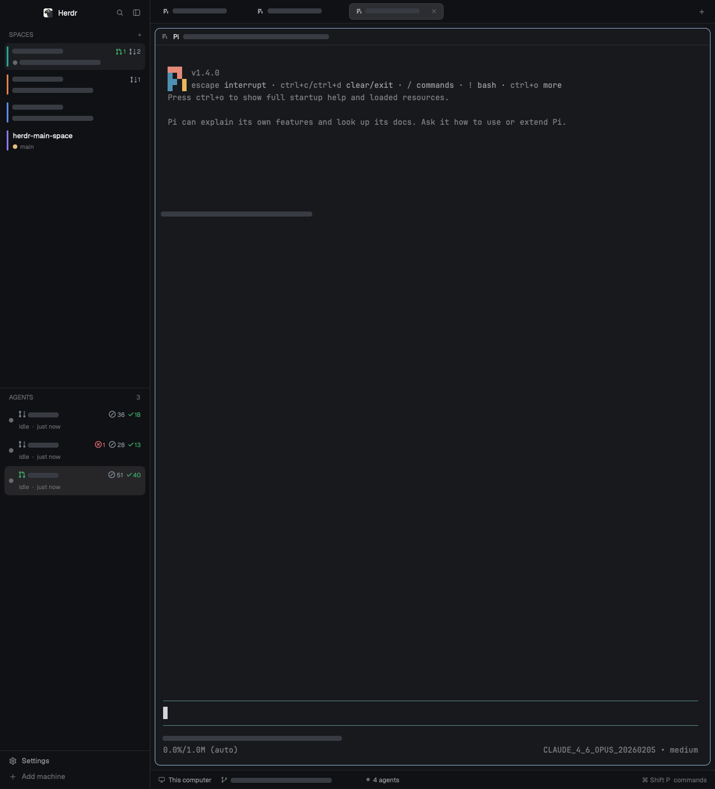

# Github Spaces

A terminal workspace with a quiet left sidebar: colored letter badges identify spaces, with attention counts and pull-request totals grouped by state. The list beneath shows only the selected space's agents. Agent rows can show a pull-request number and compact CI counts beside their activity status. Tabs sit above a large, rounded terminal card; optional Files and Changes panels open on the right. This is the `github-spaces` layout for Herdr 0.1.9. The screenshot shows space summaries and has opaque redactions over private names, PR numbers, paths, and terminal text; those redactions are not part of the layout.



## What you see

- **Left sidebar:** 268px wide initially, adjustable from 44–480px, separated from the workspace by a 1px border. A 46px brand row contains the Herdr mark, search, and sidebar-collapse controls. Below it, Spaces and Agents split the remaining height equally, each with a 90px minimum. A 69px footer holds Settings and Add machine.
- **Spaces:** a 31px heading with a + button, followed by a scrolling list. Rows are 32px high, with 8px horizontal padding, 8px gaps, and 8px corner radii. Each 18px square badge has 5px corners and the first character of the space name, uppercase, in white 10.5px bold text. Badge colors cycle through teal `#22a99a`, orange `#e3814f`, blue `#5b8def`, violet `#8b7cf6`, green `#3fae6a`, and pink `#d9649a`. Names use 13px text and truncate when necessary; hovering reveals the full name. To the right, 12px PR glyphs and 11px counts show nonzero totals in open, draft, merged, closed order. A trailing ! badge and count show agents needing attention, using the theme's blocked color if any are blocked, otherwise its done color.
- **Agents:** a 1px top divider and a 31px "AGENTS" heading with an agent count on the right, followed by scrolling 52px two-line rows with 8px padding, 2px gaps, and 8px corner radii. An 8px colored dot on the left indicates status (working, blocked, done, idle) using the theme's semantic colors. The first line shows the agent name (or PR glyph and number when matching status data exists). The second line shows a colored status label ("working", "needs you", "done", "idle") followed by a middle-dot separator and context: elapsed time for working agents, a context hint for blocked agents, or time-ago for done/idle. CI counts appear only when nonzero, ordered failed, pending, skipped, passed. The selected row uses the theme's selected background. Elapsed times refresh every 30 seconds.
- **Tabs:** a 42px strip with 29px pills, 7px corners, 12.8px text, program icons, and labels capped at 170px. The active tab has a border and close button. A + menu sits after the scrolling tabs. Files and Changes toggles appear when enabled in the user's workspace preferences; both were disabled in the photographed setup.
- **Workspace:** 8px outer padding and gaps. Every pane, including a lone terminal, has a 10px radius, 1px border, and an accent border when focused. Its always-visible 30px header shows the program, folder, and status. Terminal padding is 14px vertically and 12px horizontally.
- **Right panel:** hidden initially; 368px wide when opened, adjustable from 280–900px. Files and Changes occupy the same stack, one visible at a time.
- **Bottom status:** a 34px strip shows the machine, branch when available, total agent count across all spaces, blocked-agent count, and command-palette shortcut.

The layout inherits the user's theme and fonts. The photographed dark Graphite appearance has a `#101114` sidebar and `#17191d` terminal background, with `#262629` selection. Use semantic theme colors for borders, text, selection, and activity so light themes also work. Herdr's default fonts are Geist for controls and JetBrains Mono at 14px for terminals. Symbols Nerd Font supplies PR and CI glyphs.

## How it behaves

| Agent status | Agent list | Tabs and pane header |
| --- | --- | --- |
| Working | 8px green dot + "working" label with elapsed time (e.g. "working · 2h 14m") | Same spinner |
| Blocked | 8px blocked-color dot + "needs you" label with context (e.g. "needs you · approve plan") | Colored dot on the tab; "Needs you" badge in the pane header |
| Done | 8px done-color dot + "done" label with time ago (e.g. "done · 5m ago") | Colored dot on tab and header |
| Idle | 8px dim dot + "idle" label with time ago (e.g. "idle · 2h ago") | No activity marker |

PR colors are green `#3fae6a` for open, gray `#8b949e` for draft, purple `#a371f7` for merged, and red `#e06c75` for closed. CI uses red for failed, amber `#d29922` for pending, gray for skipped, and green for passed. Hovering a CI glyph/count explains its count and state. PRs and CI are separate from agent activity.

Each space counts blocked agents and unseen finished agents as needing attention. Live blocked/error child agents also count, including nested children; completed children report to their parent and do not add a done count. Hovering the attention badge gives the blocked/finished breakdown. Attention updates immediately with Herdr's live state, including when a finished agent is viewed. PR counts cover matching panes in every tab of that space, even if a pane is now a shell. Multiple panes or worktrees on the same repository/PR count once per space; PR numbers from different repositories stay separate. Hovering a PR count names its state. Missing status data hides PR totals while leaving attention visible.

Click a space to select it; click + beside Spaces to start one. Space badges keep their assigned colors for the lifetime of that mod copy. Click an agent to focus its pane. Rows highlight on hover. The agent list filters immediately when the selected space changes; with no selected space it shows all agents. An empty list is blank beneath its heading.

Click a tab to select it, double-click to rename, right-click for its menu, or drag between tabs to reorder. Scrolling vertically over the tab strip goes to the previous/next tab. The + menu offers a terminal and installed agents. Click the active tab's × to close it. Hover a pane header to reveal split-right, split-down, zoom/unzoom, and close buttons. Clicking the header focuses that pane. The top-edge pane grip moves panes inside a split tab; dropping centrally swaps them, and dropping on an edge places them beside one another.

Files expands folders and shows read-only text previews. Changes shows modified files and diffs; its Commit action stages **all changes in that repository** and commits the entered message. Files/Changes toggle the right panel, with the last choice remembered per space. Settings, Add machine, search, and the footer's commands label open Herdr's corresponding interfaces. Drag the brand or empty tab-strip area to move the window.

There are no bundled key overrides. Existing Herdr bindings remain in charge. On the photographed Mac, Cmd-T creates a tab, Cmd-N creates a space, Ctrl-Tab switches tabs, Cmd-D/Cmd-Shift-D split, Cmd-Shift-Enter zooms a pane, Cmd-B hides/shows the sidebar, Cmd-Shift-P opens commands, and Cmd-Shift-L switches layouts. These shortcuts depend on the installed key map.

## Built from

Build against an installed Herdr runtime, using its current `herdr.d.ts` and `gpui-kit.d.ts`. Mods use `View`, `div`, `svg`, and `image` from `gpui-kit`, plus `h_flex` and `v_flex` from `gpui-base`; there is no DOM or browser CSS. Read the target machine's `~/.config/herdr-app/AGENTS.md` before installing.

Create this tree in `layouts/github-spaces.json`; node IDs are part of the contract with the shipped controls:

```text
root row: canvas background, 1px border divider, titlebar none
├─ sidebar column: 268px, min 44, max 480, chrome, resizable false
│  ├─ brand block: 46px, workspace-chrome, window_drag
│  ├─ sidebar-lists column
│  │  ├─ spaces block: weight 1, min 90, spaces-letter
│  │  └─ agents block: weight 1, min 90, agents-space
│  └─ sidebar-footer block: 69px, workspace-chrome {footer:true}
└─ work column: remaining width, resizable false
   ├─ tabs block: 42px, tabs, window_drag
   ├─ work-body row: padding 8, gap 8
   │  ├─ main block: tab active, pane frames described above
   │  └─ panel column: hidden, 368px, min 280, max 900
   │     └─ panel-body stack: active files
   │        ├─ files block: files
   │        └─ changes block: changes
   └─ status block: 28px, workspace-status
```

Set `traffic_lights: [12,16]`, `terminal_padding: [14,12]`, and the pane header to `pane` with `reveal: "always"`, `position: "top"`, `height: 30`, and `lone: true`. The supplied layout records its origin as a clone of `main` from 0.1.9.

**Packaged custom mods:** `spaces-letter` and `agents-space`, each with `main.js` and `mod.json`. `spaces-letter` also includes `summary.js`. Both manifests use `place: "none"`; the layout places them. The shared PR/CI glyph font and its upstream license are bundled in `agents-space/fonts/SymbolsNerdFont-Regular.ttf` and `agents-space/fonts/LICENSE`; keep that folder installed for both lists.

- `spaces-letter` reads `spaces()`, `agents()`, `panes()`, `terminals()`, and `theme()`. Its clicks call `run("space.select", {id})` and `run("space.new")`. It keeps badge colors in memory. `summary.js` joins panes to spaces through tab IDs, matches the PR cache by machine/cwd/branch, and deduplicates by PR URL or repository/number (older cache entries fall back to machine/cwd/number). Child-agent attention follows terminal parent addresses back to a listed agent. Read the optional status file once, then use `watchFolder()` and `readTextFile()` for changes. Missing/unreadable/invalid status becomes an empty PR map. Live Herdr data needs no polling.
- `agents-space` reads `focused()`, `agents()`, `panes()`, `spaces()`, and `theme()`. Join agents to panes by `agent.pane === pane.pane`, then look up PR state by machine, pane cwd, and branch. On row click call `run("pane.focus", {pane: agent.pane})`. Read status once, then use `watchFolder()` and `readTextFile()` to update it. Missing/unreadable/invalid JSON becomes an empty PR map. Use `.spin(900)` for activity, never a redraw timer.
- Neither custom list block needs props.

**Shipped dependencies:** use Herdr's installed `workspace-chrome`, `tabs`, `pane`, `files`, `changes`, and `workspace-status`; they are intentionally not copied over the app's own files. Chrome receives `{footer:true}` only in the footer. Herdr supplies `{pane,terminal}` to each pane-header copy. Other blocks need no props. Supporting menus/dialogs come from installed `menu`, `new-menu`, `picker`, `machine-add`, `prompt`, `confirm`, `worktree`, and `peek`. The brand image comes from `frame/welcome/herdr.png`; spinner and control SVGs come from the shipped mod folders, and program icons come from Herdr's program table.

Shipped controls call `tab.select/new/rename/move/close/prev/next`, `pane.focus/split/zoom/close`, `layout.resize/select/show/hide`, `app.settings`, `app.palette`, `mod.open`, and native window commands. They use `layout()`, `window()`, `props()`, `settings()`, `shared()/setShared()`, `openOverlay()`, and per-copy `localStorage` for layout context and preferences. File and change panels additionally run local or remote `sh`/PowerShell and Git commands via `exec()`, read the focused working directory, and watch local folders. The Changes commit button runs `git add -A` followed by `git commit -m`.

**Optional PR helpers:** include `mods/space-status/` as a Go helper folder, not a renderable mod. Build once with Go 1.27+ (the program uses only the standard library); runtime dependencies are Git and authenticated `gh` for status refresh, plus `hc` for notifications. From the installed helper folder:

```sh
cd ~/.config/herdr-app/mods/space-status
go build -o space-status .
./space-status refresh --repo /path/to/your/repository
```

`refresh` runs Git worktree/branch queries, lists up to 40 open PRs plus the latest 100 PRs of any state authored by the authenticated user using `gh pr list`, resolves the repository using `gh repo view`, then queries the last commit's first 100 check contexts through `gh api graphql`. Open PRs take precedence when a branch name has been reused; otherwise the newest listed PR for the branch wins. If the history query fails, open PRs remain available. It collects the branch keys, repository, PR state/number, and CI counts consumed by both lists. It refreshes every 60 seconds after each pass and writes only when content changes, atomically beside the binary. `--once` runs one pass; `--output /path/status.json` is useful for testing. It does not start itself when Herdr opens.

The same binary also preserves the PR notification watcher: run `./space-status pr-watch --repo /path/to/your/repository` to poll open PRs and forward updates to matching live Pi agents. It infers `OWNER/NAME` with `gh repo view`; `--github-repo OWNER/NAME`, `--state PATH`, and repeatable `--skip ADDRESS` options are available. It uses `hc ls/get/send` and stores state under `~/.config/herdr-app/mods/space-status/pr_watch_state.json` by default. It does not start itself when Herdr opens.

The status format is `{"prs": {...}}`. Keys are compact JSON strings of `[machine,cwd,branch]`, with local machine represented by `null`. A PR value contains `repository` (`owner/name`), `number`, `state`, `isDraft`, `failed`, `pending`, `passed`, `skipped`, and `total`, or is `null` when unmatched. Use JSON stringification without spaces, preserving Unicode exactly as JavaScript does. Both list mods read `~/.config/herdr-app/mods/space-status/status.json`; the helper produces local-machine keys only.

## Watch out

- **List scope:** Spaces is a flat list of badges, names, and summaries. Agents is a flat list filtered to the selected space; there are no sorting controls, pins, or child-agent trees. Blocked children contribute to the space summary even though this Agents list does not display them. It does not call `setAgentOrder`, so agent-next/previous may not follow the filtered list.
- **Narrow-sidebar limitation:** the shipped collapse control shrinks the sidebar to 76px on macOS or 44px elsewhere, but these simplified custom lists do not render a compact rail. Content can clip. On macOS the collapsed chrome also hides the expand control, and this Agents list does not supply the expected replacement. Recover with `herdr-app do layout.resize '{"id":"sidebar","px":268}'`; hiding/showing via Cmd-B does not restore width.
- **Status scope:** the helper watches one repository's local worktree roots, only the current user's first 40 open PRs plus their latest 100 PRs of any state, with at most 100 CI contexts each. Older merged/closed PRs outside that window are absent. A pane in a subdirectory rather than an exact worktree root will not match its cache key. Remote PR enrichment is unsupported. Missing `gh` authentication leaves basic agent rows and attention useful; stopped helpers can leave stale badges. No login, scheduler, or service is installed by this bundle.
- **Paths and state:** both list mods expect the standard `~/.config/herdr-app` status path, even with a different `HERDR_APP_HOME`. Create the helper folder so their watchers have somewhere to attach. Do not distribute generated `status.json`, terminal contents, `shared.json`, `.state`, or personal settings. Helper subprocesses have a 45-second timeout; missing CI rollups produce zero counts; writes replace a temporary file beside the output.
- **Appearance and dependencies:** theme/font overrides and Files/Changes availability belong to the receiving setup. This layout itself does not freeze the screenshot's dark theme or hidden panel buttons. Built-in mod behavior may change with Herdr versions; this snapshot was checked on 0.1.9. Keep root/node IDs stable because shipped controls look them up. When names collide, rename new custom files and all their references instead of overwriting installed layouts/mods.
- **Panel limits:** Files shows at most 500 entries per folder, 5,000 total, and depth 40; text previews truncate after 400,000 characters. Changes lists at most 1,000 files and previews 1,500 diff lines, truncating lines after 4,000 characters. Both depend on the focused folder. The Changes Commit button stages the whole repository, not just the selected file.
- **Fonts and runtime:** retain each font's LICENSE. The PR glyphs use Symbols Nerd Font; missing it produces empty boxes. Use native GPUI builders and callback-local contexts, not retained `cx`, Node APIs, browser APIs, or timers for animation. The raw screenshot is not part of this public folder.

## Done when

- Both custom mods pass Herdr's mod check with no errors, and selecting Github Spaces produces the described regions without layout errors.
- Adding/selecting spaces changes the displayed terminal context. Each visible space has a colored uppercase initial. Switching spaces limits the agent rows to that space, and clicking an agent focuses its pane.
- Working, blocked, done, and idle agents display the spinner, ! badge, filled dot, and ring respectively. PR/CI badges remain independent of activity; absent status data falls back to an ordinary agent label.
- Space attention totals include blocked agents, unseen finished agents, and blocked live descendants. PR totals separate open/draft/merged/closed states and count a repository/PR only once per space, including across multiple panes/worktrees. Counts update after live state or status-file changes; empty totals stay hidden.
- With authenticated GitHub access and a matching local worktree, one helper pass produces valid status JSON and its PR number/check counts appear after the file changes. Running without the helper still leaves space/agent navigation usable.
- Tabs select, rename, reorder, and close; pane-header buttons split, zoom, and close their own pane. A single pane retains its frame. The sidebar and optional right panel resize within their stated limits.
- Files opens folders and previews text; Changes displays a temporary repository's diff. Verify its Commit action only in a disposable repository. Panel visibility is remembered per space.
- The public folder contains the layout, custom mods, helper source, font licenses, this recipe, and `preview.png`, with no live caches or private terminal text.
